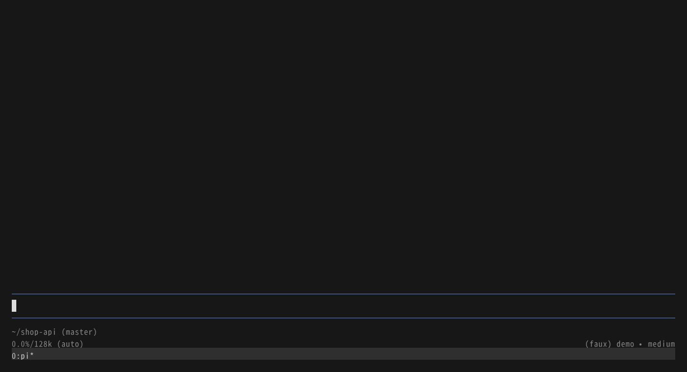

# @calliopi/calliopi-workflows

Pi floating terminal에서 fzf로 고르고 이어서 프로그램을 실행하는 워크플로우 모음입니다. `calliopi-fanout`과 같은 애플리케이션 계층이며, 다른 애플리케이션을 참조하지 않습니다.

- fzf 선택·실행기 타입: `@calliopi/core`
- floating terminal·키 입력: `@calliopi/ui`

## /cl-edit: 파일 picker + Vim

Pi 안의 floating terminal에서 파일 하나를 선택하고 편집합니다. Rex나 외부 터미널 창을 사용하지 않습니다.

```text
/cl-edit → fzf → Enter → Vim → :wq 또는 :q → Pi로 복귀
```

루트에서 `npm install` 후 Pi에서 `/reload`합니다. 시스템 `PATH`에 `rg`, `fzf`, `vim`이 필요하고 `bat`은 선택 사항입니다. macOS/Linux의 대화형 Pi를 지원합니다. 최소 크기는 40칸 × 12줄이며 fullscreen·regular 모드 모두 사용할 수 있습니다.

- 현재 Pi 작업 디렉터리에서 `rg --files`로 검색합니다. ignored·hidden 파일은 기본 제외합니다.
- fzf에서 `Esc` 또는 `Ctrl+C`는 선택 취소입니다. `Enter`로 파일 하나를 엽니다.
- Vim에서 `:wq`는 저장 후 종료, `:q`는 종료, `:q!`는 저장하지 않고 종료입니다. `Esc`는 Vim의 모드 전환이며 창을 닫지 않습니다.
- fzf/Vim이 열려 있는 동안 키 입력은 Pi 대신 해당 프로그램에 전달합니다. 창 크기 변경은 PTY에도 반영합니다. v1은 키보드 전용이며 마우스 입력은 전달하지 않습니다.
- 한글 등 IME 입력은 조합이 끝난 글자만 전달합니다. 자모 키 이벤트를 포함해 해석하지 못한 Kitty 키 이벤트는 내부 프로그램에 넘기지 않습니다.
- 입력 문제 진단: `/cl-edit --debug-input`은 받은 키 시퀀스와 변환 결과를 `$TMPDIR/calliopi-input-*.jsonl`(0600)에 기록합니다. **입력한 내용이 그대로 남으므로** 확인 후 삭제하세요.
- 편집기는 시스템 `vim`이며 사용자 Vim 설정은 그대로 읽습니다. `$EDITOR`/`$VISUAL` 선택과 여러 파일 추적은 아직 지원하지 않습니다.

### Pi로 변경 사항 전달

선택한 파일을 **Vim 실행 직전과 종료 직후** 비교합니다. `git diff HEAD`가 아니므로 기존 미커밋 변경과 이번 편집을 구분할 수 있고, untracked 파일도 지원합니다.

- 변경이 있으면 경로와 diff를 `calliopi-file-edit` 메시지로 **다음 사용자 턴에 전달**합니다. 자동으로 모델을 실행하거나 리뷰를 요청하지 않습니다.
- 변경이 없거나 선택을 취소하면 메시지를 추가하지 않습니다.
- 선택한 파일만 추적합니다. Vim에서 연 다른 버퍼는 추적하지 않으며, 편집 중 다른 프로세스가 같은 파일을 바꾸면 그 변경도 포함될 수 있습니다.
- 파일이 1 MiB를 넘거나 바이너리/non-UTF-8이면 내용을 첨부하지 않습니다. diff가 24 KiB 또는 400줄을 넘으면 경로·크기·생략 사유만 전달합니다. diff 생성용 `git`이 없어도 편집은 가능하며 경로·크기만 전달합니다.
- `.env*`, credential/secret 파일명, 개인 키·인증서 경로는 picker와 preview에서 제외합니다. **파일명 기반 방어이지 파일 내용의 비밀 탐지 기능은 아닙니다.** 프로젝트 밖의 경로나 symlink 대상도 제외합니다.
- 다음 턴 메시지는 Pi의 `nextTurn` 큐를 사용합니다. 전송 전에 종료하거나 `/reload`할 경우까지 별도 복구를 보장하지 않습니다.
- `/reload`·세션 교체·Pi 종료 시 PTY와 임시 파일을 정리합니다. Vim에서 저장하지 않은 내용의 복구는 보장하지 않습니다.

## /cl-log: git 기록 탐색

같은 floating terminal에서 커밋 → 변경 파일 → diff 순서로 탐색합니다. **보기 전용**이며 Pi 대화에 아무것도 전달하지 않습니다.

터미널 폭이 100칸 이상이면 **분할 화면**입니다. 왼쪽과 오른쪽 모두 실제 fzf라서, 오른쪽 변경 파일 목록에도 들어가 검색·선택할 수 있습니다.

```text
╭ Commits ────────────┬ Files · 9771367 ─────────────╮
│ > 9771367 Add…      │ > +50 -0  lib/fzf.ts         │   왼쪽 커서를 옮기면
│   69a5fd5 Ren…      │   +93 -0  lib/git-log.ts     │   오른쪽 파일 목록과
│                     │ ╭ diff 미리보기 ──────────╮ │   diff가 따라 바뀝니다
╰ Tab/Enter: 파일 목록 · Esc: 닫기 ────────────────╯
```

| 위치 | `Tab` / `Enter` | `Esc` | 기타 |
|---|---|---|---|
| 커밋 목록 | 파일 목록으로 | Pi 복귀 | 검색어 입력·↑↓ 이동 |
| 파일 목록 | `Tab`: 커밋 목록으로 · `Enter`: 전체 화면 diff | 커밋 목록으로 | |
| diff (delta 또는 less) | | | `q`: 파일 목록으로 |

- 커밋 fzf는 계속 실행되어 검색어·커서가 그대로 유지됩니다. 파일 fzf는 커밋을 옮길 때마다 다시 띄우며, diff를 보고 돌아오면 검색어·커서를 복원합니다.
- 커밋 커서는 fzf의 `focus` 이벤트를 개인 임시 파일로 받아 따라갑니다. 다른 로컬 프로세스가 명령을 보낼 수 있는 fzf 원격 제어 서버(`--listen`)는 쓰지 않습니다. 빠르게 스크롤할 때는 80ms 모아서 한 번만 갱신합니다.

폭이 100칸 미만이거나 `/cl-log --steps`로 열면 단계별 화면입니다.

```text
 ① 커밋 목록      미리보기: git show --stat     Enter → ② · Esc → Pi 복귀
 ② 변경 파일 목록  미리보기: 해당 파일 diff    Enter → ③ · Esc → ①
 ③ 파일 diff       delta(없으면 less)              q → ②
```

- `git`, `fzf`, `less`가 필요하고 `delta`는 선택 사항입니다. 현재 Pi 작업 디렉터리가 속한 저장소의 현재 브랜치 기록을 최근 2000개까지 보여줍니다.
- 이전 단계로 돌아오면 검색어를 유지합니다. 검색어가 없으면 직전에 고른 항목에 커서를 둡니다.
- merge 커밋은 첫 번째 부모와, 최초 커밋은 빈 트리와 비교합니다. 이름 변경은 `이전 → 이후`로 표시합니다. 변경 파일이 없는 커밋은 선택해도 커밋 목록에 머묭니다.
- pager는 이 명령 안에서만 고정합니다. 사용자의 `pager.diff` 설정을 바꾸지 않으며, diff가 짧아도 바로 닫히지 않고 `q`로 나갑니다.
- 파일 경로는 문자 그대로 다룹니다(`GIT_LITERAL_PATHSPECS`). 항목은 번호로만 주고받아 공백·탭·줄바꿈이 있는 파일명도 안전하게 처리합니다.

## /cl-run, /cl-jobs: 옆 pane에서 명령 실행



`!`로 실행한 명령은 끝날 때까지 Pi를 붙잡고, 무엇이 돌고 있는지 모아 볼 곳이 없습니다. `/cl-run`은 명령을 터미널 멀티플렉서 pane에서 실행하고 바로 돌아옵니다.

```text
/cl-run npm test                 옆 pane에서 실행 (포커스는 Pi에 남음)
/cl-run -s npm run build         백그라운드 창에서 실행 (--silent, tmux)
/cl-run -n api docker logs -f api   작업 이름 지정 (--name=api)
/cl-run ? 테스트 돌려줘          모델이 명령을 추론 → 확인(수정 가능) → 실행
/cl-jobs                         작업 목록 → 전달·이동·중지·삭제
ctrl+\ 또는 alt+k               가장 최근 작업에 Ctrl+C, 한 번 더: pane 닫기 (안 끝났으면 종료 → 강제 종료)
```

- 옵션은 명령 앞에만 둡니다. 그 뒤는 적은 그대로 `$SHELL -c`로 실행합니다. 명령이 `-`로 시작하면 `--`로 구분합니다.
- `?` 뒤에 하고 싶은 일을 적으면 지금 선택된 모델이 명령 한 줄을 추론합니다(대화 턴을 쓰지 않는 별도 요청). 근거로 작업 디렉터리의 파일 목록, `package.json` 스크립트와 lockfile로 본 패키지 매니저, Makefile 타깃, 같은 디렉터리에서 `/cl-run`으로 실행했던 명령을 보냅니다. 파일 내용은 보내지 않습니다.
- **직접 적은 명령은 확인 없이 실행하고, 모델이 쓴 명령은 반드시 편집 창에서 확인을 받습니다.** Enter로 제출한 내용(고쳤든 아니든)이 실행되고 Esc면 실행하지 않습니다. 모델이 명령을 정하지 못하면 이유를 알리고 끝냅니다. `??`처럼 겹쳐 쓰면 실행하지 않고 알려줍니다. 명령 자체가 `?`로 시작하면 `--` 뒤에 적습니다.
- 이름을 생략하면 명령의 첫 두 단어로 짓고(`npm test` → `npm-test`), 겹치면 번호를 붙입니다. 이름을 지정해 다시 실행하면 끝난 이전 기록을 대체합니다.
- 명령은 자체 pseudo-terminal에서 돌아 색·진행 표시·프롬프트가 그대로이고, pane에서 직접 입력하거나 `Ctrl+C`로 끊을 수 있습니다.
- Pi에서 끊으려면 `ctrl+\` 또는 `alt+k`를 누릅니다. 이 세션에서 시작해 실행 중인 작업 중 가장 최근 것에 보냅니다. 한 번은 pane에서 누른 `Ctrl+C`와 같습니다(명령의 터미널에 써서 foreground 프로세스 그룹 전체가 받습니다). Pi에서 `Ctrl+C`를 두 번 누르는 것처럼, 끝난 뒤 한 번 더 누르면 남아 있는 pane을 닫습니다. 그래도 안 끝났으면 3초 안에 다시 누를 때 종료 신호(SIGHUP), 한 번 더 누르면 프로세스 그룹 전체를 강제 종료(SIGKILL)합니다. `Ctrl+C`를 끈 프로그램(편집기 등)은 첫 번째로는 끝나지 않습니다.
  - 두 키 모두 Pi·tmux·herdr 기본 키와 겹치지 않습니다. `ctrl+\`는 어느 터미널에서나 전달됩니다. `alt+k`는 macOS에서 터미널이 Option을 Alt로 보낼 때만 됩니다. 기본값(특수 문자)이면 `˚`가 입력되니 터미널 설정에서 바꾸세요(Rex: 명령 팔레트의 Change Option Key Behavior → Alt).
- 끝나면 바로 알림을 띄우고, 종료 코드와 출력 마지막 40줄을 **모델에 전달해 깨웁니다**. 대화 기록에는 `✓ /cl-run npm-test · 종료 0 · 12초 · npm test`처럼 한 줄로 보이고 `ctrl+o`로 펼치면 전달한 내용이 보입니다.
  - 모델이 쉬고 있으면 바로 답합니다: 실패했으면 원인과 다음 할 일을, 성공했으면 결과를 짧게. 같은 명령을 다시 실행하지는 않습니다.
  - 모델이 작업 중이면 끼어듭니다. 지금 도구 호출이 끝나고 다음 요청을 보내기 전에 결과가 들어가므로(`steer`) 모델이 그것을 보고 방향을 바꿀 수 있습니다. 답을 쓰는 도중에 끊지는 않습니다.
  - 직접 끊은 작업(130, 129)은 확인만 하라고 전달합니다.
  - `/cl-jobs`의 "전달"은 깨우지 않고 다음 메시지에 붙여 보냅니다.
- runner가 종료 코드를 쓰는 순간을 Pi가 파일 변경으로 감지하고, 1초 간격 확인은 보조로 남깁니다. 끊겨서 끝나도(`ctrl+\`·`alt+k` 130, pane을 닫음 129) 같습니다.
- 옆 pane은 끝난 뒤에도 남아 있고 pane에서 Enter(또는 `Ctrl+C`, `q`)로, Pi에서는 `ctrl+\`·`alt+k`로 닫습니다. 백그라운드 창은 끝나면 스스로 닫힙니다. pane을 직접 닫으면 명령도 끝납니다.
- `/cl-jobs`는 이름·상태(실행 중, 종료 코드, 경과 시간)·명령을 fzf로 보여주고 오른쪽에 출력 끝부분을 미리 보여줍니다. 고른 뒤 출력 전달, 지금 화면 전달, pane으로 이동, 중지(실행 중) 또는 기록 삭제(끝난 작업)를 선택합니다.
- 작업은 `$TMPDIR/calliopi-jobs-<uid>/<이름>/`(0700)에 `meta.json`·`log`·`pid`·`exit`로 남습니다. Pi를 종료해도 작업은 계속 돌고, 다른 Pi 세션의 `/cl-jobs`에도 보입니다. 다만 완료 알림은 그 작업을 시작한 Pi 세션에만 옵니다. 끝난 지 24시간이 지난 기록은 다음 `/cl-run` 때 지웁니다.
- `log`는 터미널 출력 원본입니다. 대화에 전달할 때는 escape sequence를 지우고 `\r`로 덮어쓴 줄은 마지막 내용만 남깁니다. `vim`처럼 화면 전체를 그리는 프로그램은 로그로 읽을 수 없으니 "지금 화면 전달"을 쓰세요.

| | Rex | herdr | tmux |
|---|---|---|---|
| `/cl-run` (옆 pane) | 미확인 | 미확인 | 확인 |
| `/cl-run -s`, 화면 전달, pane으로 이동 | 없음 | 없음 | 확인 (3.4) |

Rex·herdr의 옆 pane 실행은 `/cl-preview`와 같은 어댑터 연산을 쓰지만 이 명령으로 실행해 보지는 않았습니다.

## 구조

```text
extensions/file-picker.ts   /cl-edit · 다음 턴 메시지
extensions/git-log.ts       /cl-log
extensions/run.ts           /cl-run · /cl-jobs · 완료 알림과 다음 턴 메시지
lib/editor-flow.ts          워크플로우: 파일 → Vim, 스냅샷으로 변경 비교
lib/file-edit.ts            파일 목록·경로 검사·스냅샷·diff
lib/git-log.ts              커밋·파일 목록, 단계별 워크플로우, 분할 화면(전용 구현)
lib/jobs.ts                 작업 디렉터리·상태·로그 정리·모델에 줄 메시지
lib/job-infer.ts            `?` 추론: 프로젝트 요약, 프롬프트, 응답 정리, 확인 단계
bin/job-runner.ts           pane 안에서 명령을 PTY로 실행, 로그와 종료 코드 기록
bin/job-preview.ts          /cl-jobs 미리보기
bin/file-preview.ts         bat preview / plain-text fallback (번호로 후보 조회)
bin/git-preview.ts          커밋/파일 미리보기
scripts/smoke.ts            설치된 Pi로 두 명령을 끝까지 실행하는 smoke test
```

`bin/`의 미리보기 스크립트는 `lib/`을 import하지 않습니다. fzf가 Pi를 띄운 Node로 따로 실행하기 때문입니다.

## 검증

```bash
npm test -w @calliopi/calliopi-workflows
# 설치된 Pi를 별도 PTY에서 실행해 fullscreen/regular 양쪽을 검증합니다.
# 네트워크·모델 요청 없이 임시 프로젝트만 편집합니다.
npm run smoke -w @calliopi/calliopi-workflows
```

테스트에는 실제 fzf → 실제 Vim → diff 흐름, 한글/공백/따옴표 파일명, 취소·무변경·삭제·내용 생략, 실제 fzf → pager 탐색과 분할 화면이 포함됩니다.
